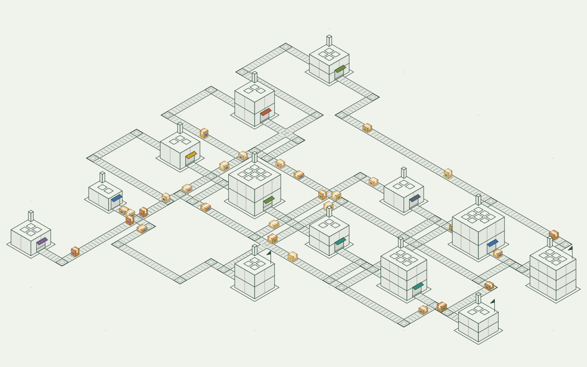

# Isometric Git

See your repo built as a factory.



Drop a repo folder on the page and it is drawn commit by commit. It runs in your browser and uploads nothing.

## How to read it

- **Machine:** a folder. More code makes it taller.
- **Hatch:** a file, on the machine's roof.
- **Belt:** what one folder imports from another. More imports, more boxes.
- **Smoke:** a commit changed files there.
- **Pennant:** nothing imports this folder.
- **Crates:** a branch was merged. Its work is set down beside each machine it changed, a crate a file.
- **Striped hatch:** both branches changed this file, and the merge settled it. Git may have settled it without asking.

## Stamps

"Make a stamp" turns the factory into a card to post: its picture, a score and a rank from Shed to Megafactory. The score is a point a file, a point a kB of source and five a belt. Pick one of four styles (classic, poster, panel, frame), change the title, colours, numbers and shape, save it as an image, or copy a challenge link. Whoever opens the link sees your stamp beside theirs. The link holds numbers and the title, which starts as the name of the folder you dropped. No file or folder inside it is named.

## Run it

```sh
bun install
bun run dev
```

`bun run build` writes a static site to `dist/`, which any static host serves. `bun test` and `bun run check` run the tests and the typecheck.

## Limits

- Belts follow JavaScript, TypeScript and CSS imports, plus Rust `mod` declarations and `use` imports. Rust resolves `crate`, `self`, `super`, grouped imports, `#[path]` modules and local Cargo dependencies, including workspace inheritance and renamed crates. Other languages get machines with no belts.
- Rust is scanned without compiling: macros and generated modules are not expanded, and conditional compilation is not evaluated. Dependencies outside the dropped repo have no belts.
- A history longer than 150 commits is sampled down to 150 steps.
- History follows the branch's own line, so a merged branch lands as one step that says how many commits it brought in. In a sampled history only the merges that fall on a step are marked, and a shallow clone's merges are marked but not counted. A repo dropped halfway through a merge or a rebase is drawn at its last commit.
- SHA-1 repos only.

## Where things are

- `src/lib` is the engine: `git.ts` reads `.git`, `scan.ts` turns history into steps, `rust.ts` resolves Rust modules and Cargo dependencies, `plan.ts` places machines and routes belts, `conveyor.ts` moves the boxes, `factory.ts` animates and paints, `stamp.ts` scores a factory and draws its stamp.
- `src/pages` and `src/components` are the page, built with [Astro](https://astro.build).
- `scripts/sample.ts` writes the made-up repo the page opens on.

Set in [Paper Mono](https://paper.design/mono), under the SIL Open Font License. Code under the [MIT licence](LICENSE).

By [Daniel](https://github.com/danielwh2).
